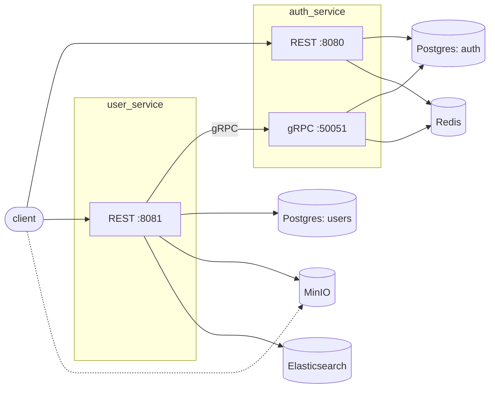

# medical-service

Бэкенд медицинского сервиса на Go: регистрация пациентов, авторизация, профили с фото и поиск врачей. Два микросервиса общаются по gRPC, наружу торчит REST.

Медкарты и запись к врачу пока не готовы, они живут в ветке `wip/medical-records-appointments`.

## Сервисы



`auth_service` хранит логины и пароли, выдаёт и отзывает JWT. Секреты подписи и Redis есть только у него.

`user_service` хранит профили пациентов и врачей, фото и поисковый индекс. Регистрирует пользователей через gRPC в auth_service и там же проверяет токен на каждом запросе.

Общий код (jwt, логгер, подключения к Postgres/Redis, proto) вынесен в модуль `internal/pkg`.

## Стек

- Go, Fiber для REST, gRPC между сервисами.
- PostgreSQL — учётки и профили. У каждого сервиса своя база и своя роль.
- Redis — blacklist отозванных токенов. Ключ живёт столько же, сколько токен, так что чистить ничего не надо.
- MinIO — фото профилей. Клиент получает presigned-ссылку и качает файл напрямую.
- Elasticsearch — поиск врачей по ФИО, специальности и услугам с нечётким совпадением.
- golang-migrate — миграции.

## Запуск

Нужны Docker (Compose v2) и make.

```bash
make up      # собрать и поднять всё
make logs    # логи сервисов
make down    # остановить, make down V=1 — вместе с volume'ами
```

После `make up` базы созданы, миграции применены, bucket в MinIO есть, админ заведён.

Порты:

- `8080` — auth_service
- `8081` — user_service
- `9000` — MinIO (на него ведут ссылки на фото), `9001` — консоль MinIO

gRPC, Postgres, Redis и Elasticsearch наружу не открыты.

### Переменные окружения

Для локального запуска ничего задавать не нужно, дефолты прописаны в `docker-compose.yaml`. Если запускаешь не у себя на машине, скопируй `.env.example` в `.env` и поменяй значения.

```
ACCESS_SECRET, REFRESH_SECRET     секреты JWT
ADMIN_EMAIL, ADMIN_PASSWORD       админ, которого auth_service создаёт при старте
POSTGRES_PASSWORD                 пароль суперпользователя Postgres
AUTH_DB_PASSWORD, USER_DB_PASSWORD пароли ролей сервисов
REDIS_PASSWORD
MINIO_ROOT_USER, MINIO_ROOT_PASSWORD
LOG_LEVEL                         debug | info | warn | error
```

Конфиги лежат в `internal/services/*/configs/config.example.yaml`, паролей в них нет. Переменные окружения перекрывают значения из yaml.

### Миграции

Лежат в `migrations/auth` и `migrations/user`. В compose их накатывают контейнеры `auth-migrate` и `user-migrate` до старта сервисов. Руками:

```bash
migrate -path migrations/user -database "postgres://user_service:<pwd>@localhost:5432/users?sslmode=disable" up
```

## Пример

Токены лежат в httpOnly-куках. Куки не привязаны к порту, поэтому то, что выдал `:8080`, уходит и на `:8081`. Локально в конфигах стоит `insecure_cookies: true`, чтобы куки работали без HTTPS.

```bash
# любая png/jpeg до 5 МБ
printf '\x89PNG\r\n\x1a\n\0\0\0\rIHDR\0\0\0\1\0\0\0\1\x08\x06\0\0\0\x1f\x15\xc4\x89\0\0\0\rIDATx\x9cc\0\1\0\0\5\0\1\r\n-\xb4\0\0\0\0IEND\xaeB`\x82' > photo.png

# админ создаёт врача
curl -s -c admin.txt -H 'Content-Type: application/json' \
  -d '{"email":"admin@example.com","password":"admin-dev-password"}' \
  http://localhost:8080/auth/login

curl -s -b admin.txt http://localhost:8081/users/doctors \
  -F 'data={"first_name":"Anna","middle_name":"Petrovna","last_name":"Sidorova","phone":"+79990000001","email":"anna@example.com","password":"doctor-password","sex":"F","birth_date":"1985-03-04","specialty":"cardiologist","work_experience":"12","description":"Cardiologist","services":["consultation","ecg"]}' \
  -F 'photo=@photo.png;type=image/png'

# регистрация пациента (фото необязательно, можно отправить обычный json)
curl -s -c patient.txt http://localhost:8081/users/register \
  -F 'data={"name":"Ivan","surname":"Ivanov","patronymic":"Ivanovich","email":"ivan@example.com","phone_number":"+79990000002","sex":"M","password":"patient-password","birth_date":"1990-01-02"}' \
  -F 'photo=@photo.png;type=image/png'

# логин
curl -s -b patient.txt -c patient.txt -H 'Content-Type: application/json' \
  -d '{"email":"ivan@example.com","password":"patient-password"}' \
  http://localhost:8080/auth/login

# профиль, в profile_picture_url ссылка на фото
curl -s -b patient.txt http://localhost:8081/users/profile/patient

# поиск врачей и карточка врача
curl -s -b patient.txt 'http://localhost:8081/users/doctors/search?specialty=cardiologist'
curl -s -b patient.txt http://localhost:8081/users/doctors/<uuid>/details

# refresh
curl -s -b patient.txt -c patient.txt -X POST http://localhost:8080/auth/refresh

# logout, а потом проверяем, что старые токены больше не работают
ACCESS=$(awk '$6=="accessToken"{print $7}' patient.txt)
REFRESH=$(awk '$6=="refreshToken"{print $7}' patient.txt)
curl -s -b patient.txt -c patient.txt -X POST http://localhost:8080/auth/logout

curl -s -o /dev/null -w '%{http_code}\n' --cookie "accessToken=$ACCESS" http://localhost:8081/users/profile/patient   # 401
curl -s -o /dev/null -w '%{http_code}\n' --cookie "refreshToken=$REFRESH" -X POST http://localhost:8080/auth/refresh # 401
```

### Эндпоинты

```
auth_service :8080
  POST   /auth/login
  POST   /auth/refresh
  POST   /auth/logout

user_service :8081
  POST   /users/register
  GET    /users/profile/patient                  авторизация
  GET    /users/profile/doctor                   авторизация
  PATCH  /users/profile                          авторизация
  GET    /users/doctors/search                   авторизация  (first_name, last_name, specialty, sex, services=a,b)
  GET    /users/doctors/:doctor_id/details       авторизация
  POST   /users/doctors                          ADMIN
  DELETE /users/doctors/:doctor_id               ADMIN
```

## Как устроено

### Отзыв токенов

В токене лежат `sub` (id пользователя), `jti` (id самого токена), `role` и `typ` (ACCESS или REFRESH). При logout `jti` записывается в Redis с TTL до истечения токена. Отзывается только эта сессия, остальные сессии пользователя продолжают работать.

user_service не проверяет подпись сам, а на каждый запрос вызывает `ValidateAccessToken` в auth_service. Тот проверяет подпись (только HS256), срок, тип и blacklist. Так секреты и Redis есть только у одного сервиса, и отозванный токен сразу перестаёт работать везде. Плата за это — лишний gRPC-вызов на запрос. Если это станет узким местом, можно проверять подпись локально и кешировать blacklist.

### Refresh

Refresh смотрит только на refresh-токен. Истёкший access тут не ошибка, ради этого refresh и вызывают. Каждый refresh выдаёт новую пару, а старый refresh-токен помечается использованным. Повторно его применить нельзя, после logout тоже.

Роль лежит в обоих токенах, поэтому на refresh в базу не ходим. Минус: если роль поменяется, это заметно только после нового логина или очередного refresh.

### Регистрация

Учётка хранится в auth_service, профиль в user_service, общей транзакции нет. Поэтому регистрация идёт по шагам: учётка, фото в MinIO, профиль в Postgres, для врача ещё индекс в Elasticsearch. Если что-то падает после создания учётки, уже созданное удаляется, а в auth_service уходит `DeleteUser`. Его повторяем с растущей задержкой. Если он так и не прошёл, в лог пишется `COMPENSATION FAILED` с id пользователя, такую учётку надо удалить руками.

Откат работает на контексте без отмены (`context.WithoutCancel`): если клиент отвалился посреди запроса, откат всё равно доходит до конца.

### Мелочи

- На неверный пароль и на несуществующий email логин отвечает одинаково, по времени тоже: для несуществующего email всё равно считается bcrypt. Так нельзя узнать, есть ли email в базе.
- Повторный email определяется по коду ошибки Postgres `23505`, а не по тексту сообщения.
- Через API админа не создать, он заводится при старте из `ADMIN_EMAIL` и `ADMIN_PASSWORD`.

## Тесты

```bash
make test                          # unit-тесты всех модулей
make up && make test-integration   # полный сценарий на поднятом стеке
```

Unit-тесты написаны на testify и gomock. Покрыты:

- jwt: истёкший токен, чужая подпись, `HS512` и `alg=none`, refresh вместо access;
- логин, refresh и logout;
- регистрация и откат при ошибках;
- middleware авторизации.

Интеграционный тест лежит в `tests/` и прогоняет сценарий из примера выше целиком.

Моки генерируются через `go generate ./...` (нужен `mockgen`), gRPC-код — через `make proto`.

## Структура

```
internal/pkg/                  общий модуль
internal/services/auth_service
internal/services/user_service
migrations/                    миграции по сервисам
deploy/postgres/               создание баз и ролей
tests/                         интеграционный тест
```

## TODO

- медкарты и запись к врачу (ветка `wip/medical-records-appointments`)
- события между сервисами через Kafka
- TLS для gRPC (клиент уже умеет, см. `cert_file_path`)
